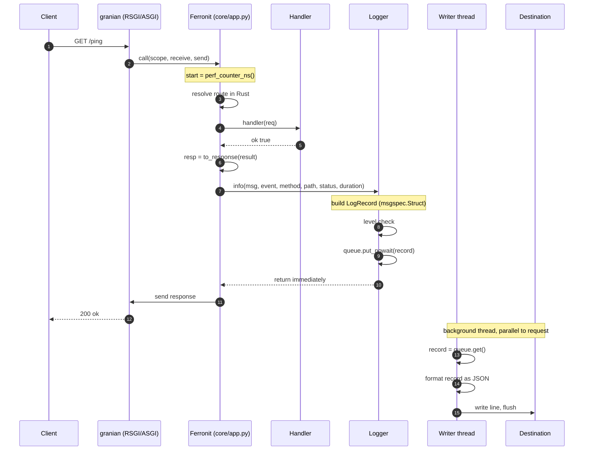
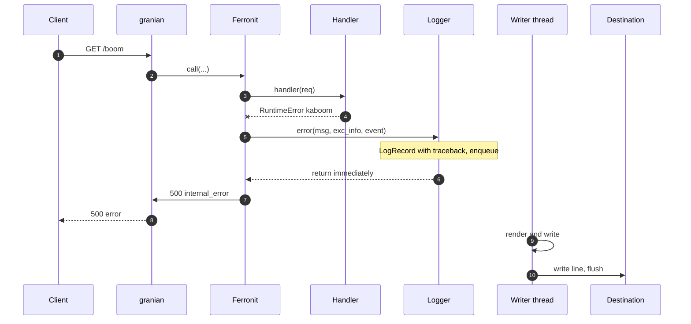

# Логирование

Ferronit получает логгер через конструктор и пишет в него access- и error-записи.
Интерфейс задан протоколом `LoggerProtocol`, а готовая реализация — класс `Logger`
(неблокирующая, JSON/текст, с гарантией доставки). Без инъекции используется
`StdlibLogger` — тонкий адаптер над стандартной библиотекой `logging`.

## Быстрый старт

```python
from ferronit import Ferronit
from ferronit.contrib.logging import Logger, LogConfig

logger = Logger(LogConfig())                      # JSON → stderr
app = Ferronit(logger=logger, access_log=True)    # access-log через логгер

logger.flush()                                    # гарантия доставки (по надобности)
logger.shutdown()                                 # слить очередь и остановить поток
```

- `Logger(LogConfig(...))` — основной класс, конфигурирует пайплайн.
- `setup_logging(**kwargs)` — сахар, эквивалентный `Logger(LogConfig(**kwargs))`.
- Без `logger=` Ferronit использует `StdlibLogger("ferronit")` — записи идут в
  стандартную библиотеку `logging` (если она настроена — в её приёмники).

## Архитектура

```python
class LogRecord(msgspec.Struct):     # структурированная запись (одна JSON-строка)
    ts, level, logger, caller, msg
    trace_id, exc, fields            # fields — словарь произвольных полей

class LoggerProtocol(Protocol):      # интерфейс, который использует Ferronit
    def debug/info/warning/error/critical(msg, **fields): ...

class Logger:                        # основная реализация протокола
    def __init__(self, config: LogConfig): ...
    def debug/info/warning/error/critical(...)  # собирают LogRecord в очередь (O(1))
    def flush()                      # ждать записи всего накопленного
    def shutdown()                   # слить очередь, остановить поток (+atexit)

class StdlibLogger:                  # адаптер над logging.getLogger(name)
    def info/warning/error(...)      # синхронно, без фонового потока
```

`Ferronit` знает только протокол (`info`/`warning`/`error`) и не зависит от
конкретной реализации — можно подставить свой логгер (например, в тестах — заглушку,
в проде — отправку в коллектор).

## Как это работает (Logger)

- **Неблокирующий `emit`.** `info/warning/error` только кладут `LogRecord` в
  неограниченную очередь (`queue.Queue`, O(1)) и возвращаются. Запись в поток/файл
  выполняет **один фоновый поток**, поэтому запрос никогда не блокируется на I/O.
- **Гарантия доставки.** `flush()` блокируется, пока всё, что уже попало в очередь,
  не будет записано. `shutdown()` сливает очередь и останавливает поток; он же
  зарегистрирован в `atexit`, поэтому при штатном завершении записи не теряются.
- **Без stdlib `logging`.** `Logger` собирает `LogRecord` сам (без `findCaller` и
  аллокации `logging.LogRecord`), поэтому `info/warning/error` в горячем пути
  дёшевы, а поле `caller` указывает реальное место вызова.
- **Фильтрация уровней.** `LogConfig.level` отсекает записи ниже порога прямо в
  `emit` (целочисленное сравнение, до построения записи).

## Формат JSON

Одна строка = один JSON-объект:

```json
{"ts": "2026-01-15T12:34:56.789123Z", "level": "INFO", "logger": "ferronit",
 "caller": "ferronit.core.app:_log_access:128", "msg": "GET /ping 200 0.142ms",
 "fields": {"event": "access", "method": "GET", "path": "/ping", "status": 200, "duration_ms": 0.142}}
```

Поля: `ts` (ISO-8601 UTC, `Z`), `level`, `logger`, `caller`, `msg`. Всё, что
передано keyword-аргументами, попадает в объект `fields` (структурированное
логирование):

```python
logger.info("order created", order_id=42)
# → {"fields": {"order_id": 42}, ...}
```

Текущий `X-Trace-Id` попадает в `trace_id`, необработанное исключение — в `exc`
(полный трейсбек). Значения, не сериализуемые в JSON, падают в строку через
`default=str`.

## Человекочитаемый формат

```
2026-01-15 12:34:56 | INFO     | ferronit | GET /ping 200 0.142ms | event=access method=GET path=/ping status=200 duration_ms=0.142
```

Трейсбек выводится с новой строки.

## Access-log и error-log

Ferronit пишет оба через инъектированный логгер, различая их полем `event`
внутри `fields`:

- **access-log** — каждый запрос: `event="access"`, `method`, `path`, `status`,
  `duration_ms`. Включается флагом `Ferronit(access_log=True)`.
- **error-log** — необработанное исключение хендлера: `event="error"` + `exc` с
  трейсбеком. Работает всегда (когда `debug=False`; в `debug=True` исключение
  пробрасывается наружу).

## Конфигурация

`LogConfig` (или keyword-аргументы `setup_logging`):

| Параметр | По умолчанию | Описание |
|---|---|---|
| `level` | `"INFO"` | минимальный уровень (`"DEBUG"`, `"INFO"`, ...) |
| `fmt` | `"json"` | `"json"` или `"text"` |
| `stream` | `sys.stderr` | поток вывода (взаимоисключающе с `filename`) |
| `filename` | `None` | файл (append-режим), взаимоисключающе со `stream` |
| `logger` | `"ferronit"` | логическое имя логгера (поле `logger` каждой записи) |

## Ограничения

- **Неограниченная очередь** — плата за «не блокировать и не терять»: если запись
  на диск медленнее поступления записей, память может расти. Для экстремальных
  объёмов держите `level=INFO`/`WARNING` и быстрый приёмник (stderr → внешний
  коллектор).
- **Гарантия — до уровня процесса.** `atexit`/`shutdown()` покрывают штатное
  завершение; `SIGKILL` или падение интерпретатора теряют записи, как у любого
  in-process логгера.
- **Без `fsync`** — `flush()` доставляет запись в поток и сбрасывает буфер Python,
  но не форсирует запись на диск (это поведение `logging` по умолчанию).

## Схема логирования

Успешный запрос (access-log включён): запись собирается и кладётся в очередь **на пути
запроса** (O(1), без I/O), а рендер и запись в приёмник делает фоновый поток.



Необработанное исключение (error-log): то же самое, но с полем `exc` = трейсбек.



Отрендеренные PNG: [happy path](img/logging-happy-path.png) · [error](img/logging-error-path.png).

## Планы (roadmap)

- **Цветной консольный вывод** для `fmt="text"` — ANSI-подсветка по уровням,
  включается/выключается по `isatty()` (или флагом `colorize`).
- **Ограниченная очередь** — опциональный `maxsize` с политикой `drop-oldest` /
  `drop-newest` как защита от неконтролируемого роста памяти (сегодня очередь
  неограниченная ради «не блокировать и не терять»).
- **Ротация файлов** — `logging.handlers.RotatingFileHandler`/`TimedRotatingFileHandler`
  как опция назначения.
- **Мост к доменному `Logger`** — адаптер, прокидывающий `hexagonal.Logger`
  (порт `Port`) в этот же пайплайн, чтобы доменные `info/warning/error` попадали
  в тот же JSON-поток с `trace_id`.
