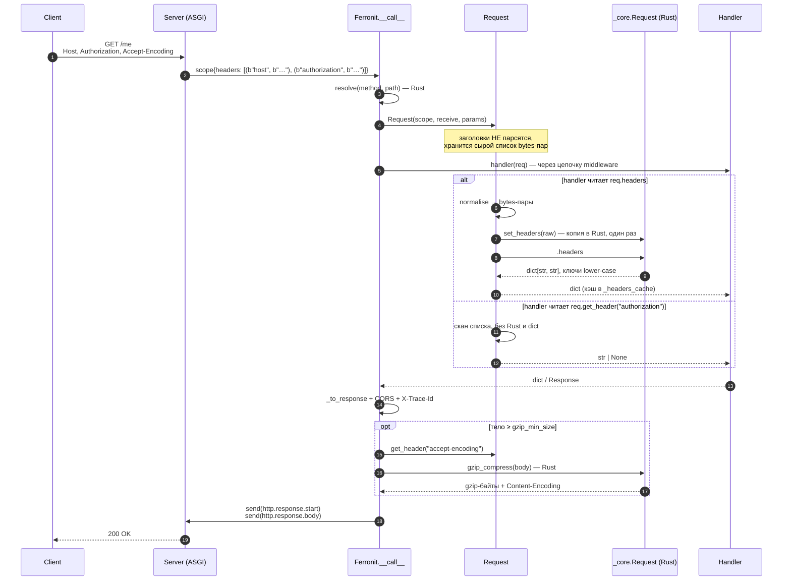
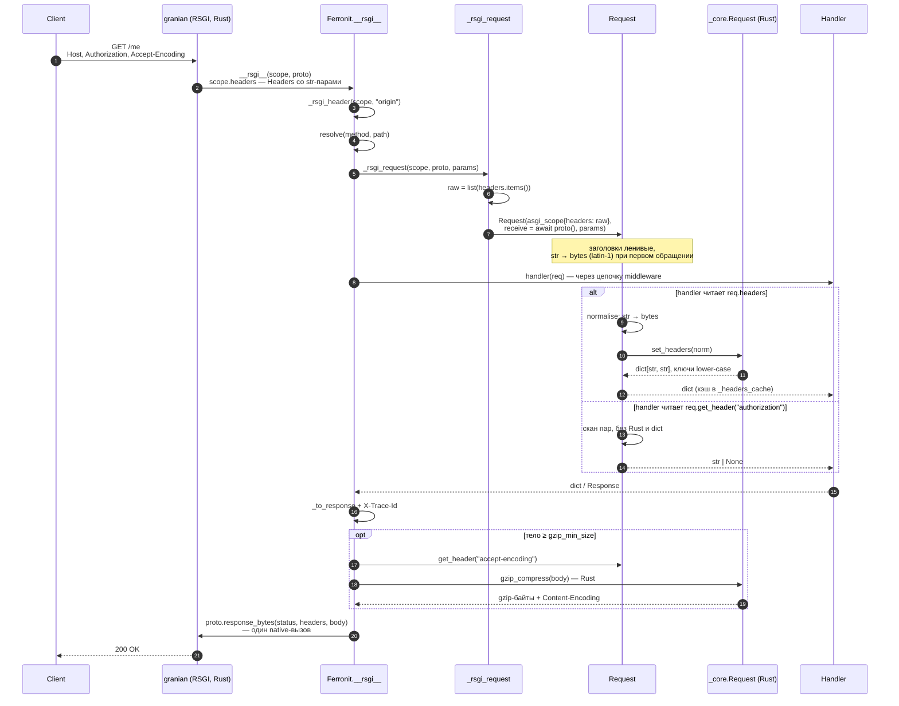

# Запросы

## Зачем

`Request` оборачивает ASGI scope, но разбор заголовков и строки запроса вынесен
в **Rust** и происходит лениво — при первом обращении, с кэшированием на время
жизни запроса. Хендлеру, которому заголовки не нужны, не платит за их разбор.

```python
from ferronit import Ferronit

app = Ferronit()

@app.route("/inspect", methods=["GET"])
async def inspect(req):
    return {
        "method": req.method,
        "path": req.path,
        "params": req.params,
        "query": req.query,
        "headers": req.headers,
    }
```

## Атрибуты и методы

| Член | Тип | Примечания |
|---|---|---|
| `req.params` | `dict[str, str]` | path-параметры маршрута |
| `req.method` | `str` | например `"GET"` |
| `req.path` | `str` | путь без query-строки |
| `req.headers` | `dict[str, str]` | ключи в нижнем регистре, повторы склеены по RFC, лениво |
| `req.get_header(name)` | `str \| None` | регистронезависимый одиночный поиск (первое значение) |
| `req.get_all(name)` | `list[str]` | **все** значения повторённого заголовка, в порядке провода |
| `req.query` | `dict[str, list[str]]` | **каждое значение — список** (повторы сохраняются) |
| `req.cookies` | `dict[str, str]` | разобранный `Cookie` (несколько заголовков склеиваются) |
| `req.get_cookie(name, default=None)` | `str \| None` | одна cookie |

Значения query — всегда списки: `?a=1&a=2` → `{"a": ["1", "2"]}`. Для
типизированного скаляра используйте [привязку параметров](binding.md).

## Чтение тела

```python
body: bytes = await req.body()          # всё тело; BodyTooLarge при превышении лимита
data = await req.json()                 # разбор JSON; RequestError (→400, код invalid_json) при ошибке
user = await req.model(UserModel)       # декод в msgspec/dataclass/pydantic
```

- `body()` стримит ASGI-чанки. Если приложение создано с `max_body_size`,
  превышение лимита бросает `BodyTooLarge` → **413**.
- `model()` имеет быстрый путь для `msgspec.Struct` — декод из байтов одним
  C-проходом; Pydantic и dataclass идут через зарегистрированный кодек
  (см. [ответы и сериализация](responses.md)).

## Формы и файлы

```python
fields = await req.form()    # urlencoded → {name: [values]}; multipart → только текстовые поля
files = await req.files()    # multipart → {name: [UploadedFile]}
```

`UploadedFile`:

```python
f.filename       # исходное имя файла
f.content        # bytes
f.content_type   # content type части
f.size           # len(content)
f.save("/tmp/out.bin")
```

Разбор multipart выполняется в Rust, файлы держатся в памяти в рамках
`max_body_size`:

```python
@app.route("/upload", methods=["POST"])
async def upload(req):
    files = await req.files()
    for upload in files.get("file", []):
        upload.save(f"/data/{upload.filename}")
    return {"saved": len(files.get("file", []))}
```

Неверный content type (`form()` на JSON, `files()` на не-multipart) бросает
`UnsupportedMediaType` → **415**.

## Лимит размера тела

```python
app = Ferronit(max_body_size=10 * 1024 * 1024)   # 10 MiB → 413 при превышении
```

## Заголовки: путь ASGI и RSGI

Ferronit принимает запрос двумя транспортами: `__call__` (ASGI — uvicorn, granian
`--interface asgi`) и `__rsgi__` (RSGI — granian, основной прод-путь). Заголовки приходят
в них по-разному, но дальше попадают в один и тот же `Request`, где **парсятся лениво**:
пока хендлер не обратился к `headers`/`get_header`, заголовки только хранятся.

### ASGI: `scope["headers"]` — уже bytes-пары



Картинкой: [`img/headers-asgi.png`](img/headers-asgi.png).

### RSGI: `scope.headers` — объект со str-парами



Картинкой: [`img/headers-rsgi.png`](img/headers-rsgi.png).

**Почему нет `str → bytes`:** ядро принимает сырые пары как есть — ASGI отдаёт `bytes`,
адаптер RSGI — `str`, — и сравнивает имена без промежуточной строки, декодируя только
совпавшие значения. Промежуточный
bytes-список не строится: `get_header()`, `get_all()`, `cookies` и `headers` целиком
исполняются в Rust (0,5–0,8 мкс на точечный доступ, ~3 мкс на полный dict из 23 полей).

**Дубликаты.** Повторённый заголовок (`X-Tag: a` + `X-Tag: b`) доходит до `Request` целиком.
`headers` склеивает значения в порядке провода через `", "` (RFC 9110 §5.2), `cookie` —
через `"; "` (RFC 9113 §8.2.3), `set-cookie` не склеивается вовсе и оставляет первую строку
(RFC 6265 §4.1.1). `get_header` возвращает первое значение, `get_all` — все по порядку.

**Лимиты сервера** (не потеря, а явная ошибка): granian отдаёт **431** при >100 заголовках
и при значении ~1 МБ (256 КБ проходят); uvicorn 120 заголовков принимает. Пустое значение
(`X-Empty:`) доходит как `""`, а не как `None`.

**Ограничение granian (RSGI):** `RSGIHeaders::items()` отдаёт только значения, проходящие
`HeaderValue::to_str()`, то есть visible ASCII. Заголовки с байтами ≥ `0x80` (UTF-8 имя,
obs-text) в RSGI **теряются целиком** — проверено: `X-Test: <D0 BF>` (валидный UTF-8) и
`X-Test: <E9>` пропадают, тогда как uvicorn ASGI и granian ASGI отдают эти байты как есть.
Ferronit больше не конвертирует str↔bytes для этого пути, так что ограничение остаётся
целиком на стороне granian. Если приложению нужны не-ASCII значения заголовков, нужен
ASGI (или тело/query).

### Чем отличаются

| | ASGI (`__call__`) | RSGI (`__rsgi__`) |
|---|---|---|
| Заголовки в scope | `list[tuple[bytes, bytes]]` (спека ASGI) | `rsgi.Headers`, `.items()` → пары `str` |
| Форма пар для `headers` | `bytes` (как в scope) | `str` (как в `RSGIHeaders.items()`) |
| Копия списка заголовков | нет (список из scope переиспользуется) | `list(scope.headers.items())` — одна копия на запрос |
| CORS/OPTIONS читает | `_scope_header(scope, …)` — из ASGI-scope | `_rsgi_header(scope, …)` — из нативного scope |
| Ответ | два события `send` (start + body) | один `proto.response_bytes(status, headers, body)` |
| Тело запроса | `receive()` по событиям | `await proto()` — один вызов |
| Цена, если заголовки не нужны | 0 | 0 (кроме копии списка) |
| `headers` (dict) впервые | `set_headers` (incref) + один проход и склейка в Rust, дальше кэш | то же |
| `get_header(name)` | скан в Python: без Rust и без `dict` | то же |
